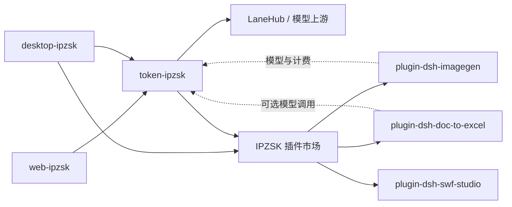

# IPZSK Web

IP 知识库（IPZSK）的网页端，负责官网展示、AI 创作工作台、账户与账单、内容管理和插件开发者入口。

## 在线地址

| 页面 | URL | 用途 |
| --- | --- | --- |
| 官网首页 | [https://www.ipzsk.com/](https://www.ipzsk.com/) | 产品介绍、客户端下载和功能入口 |
| 图片工作台 | [https://www.ipzsk.com/studio?kind=image](https://www.ipzsk.com/studio?kind=image) | 文生图、图生图、素材与任务管理 |
| 视频工作台 | [https://www.ipzsk.com/studio?kind=video](https://www.ipzsk.com/studio?kind=video) | 文生视频、图生视频和任务查询 |
| 内容工作台 | [https://www.ipzsk.com/workspace](https://www.ipzsk.com/workspace) | 选题、草稿、内容和作品管理 |
| 账户中心 | [https://www.ipzsk.com/account](https://www.ipzsk.com/account) | 注册登录、余额、充值、账单和 API 凭证 |
| 开发者中心 | [https://www.ipzsk.com/developer](https://www.ipzsk.com/developer) | 开发者申请、插件登记、版本提交和用量查看 |
| 产品定价 | [https://www.ipzsk.com/pricing](https://www.ipzsk.com/pricing) | 模型价格与计费规则 |

裸域名 `https://ipzsk.com` 会跳转到 `https://www.ipzsk.com`。

## 主要功能

- 首页、产品说明、客户端下载和法律政策页面。
- 图片与视频创作：模型选择、提示词编辑、参考素材、任务队列、历史记录和结果下载。
- 内容工作台：选题、草稿、素材和已生成内容的统一整理。
- 账户系统：注册登录、余额、充值、消费记录和 API 凭证管理。
- 开发者中心：申请开发者、登记插件、提交 GitHub Release、查看插件用量和应计分成。
- 管理中台：处理站点内容与生成记录；号池、模型路由和插件审核由 [Token 服务](https://github.com/ipzsk/token-ipzsk) 管理。

浏览器保存界面状态和部分本地工作数据。身份、余额、支付核验、模型调用和插件目录统一请求 `https://api.ipzsk.com`。

## 六个仓库如何协作

| 仓库 | 职责 | 更新边界 |
| --- | --- | --- |
| [web-ipzsk](https://github.com/ipzsk/web-ipzsk) | IPZSK 官网、创作工作台、账户与开发者页面 | Web 端独立部署 |
| [desktop-ipzsk](https://github.com/ipzsk/desktop-ipzsk) | 基于 DeepSeek 官方桌面底座的 IPZSK 客户端，内置 IPZSK 插件市场 | 桌面安装包独立发布 |
| [token-ipzsk](https://github.com/ipzsk/token-ipzsk) | 账户、号池、模型路由、计费、插件审核和更新目录 | 后端服务独立部署 |
| [plugin-dsh-imagegen](https://github.com/ipzsk/plugin-dsh-imagegen) | AI 生图、改图、多模型对比、模板与画廊 | 插件 Release 独立发布 |
| [plugin-dsh-doc-to-excel](https://github.com/ipzsk/plugin-dsh-doc-to-excel) | Word/PDF 提取、分类并生成 Excel，支持大 PDF | 插件 Release 独立发布 |
| [plugin-dsh-swf-studio](https://github.com/ipzsk/plugin-dsh-swf-studio) | 宴会厅与 FloorLED 场景设计、本地 SWF 导出 | 插件 Release 独立发布 |



插件源码和版本在各自仓库维护。开发者发布 GitHub Release 后，在 Web 开发者中心提交版本；Token 服务完成审核并生成市场目录；桌面端下载审核版本、校验包名、版本、大小和 SHA-256 后安装。插件更新无需重新构建桌面客户端。

## 账户、余额与支付

- 登录、注册、余额、消费记录和充值接口由 `https://api.ipzsk.com` 提供。
- 新用户完成注册与邮箱验证后一次性赠送 ¥5.00。
- 页面统一显示人民币余额；账户中心可以发起在线充值。
- 在线充值使用 Waffo，提供 ¥10 / ¥50 / ¥100 三档。
- 付款回跳只提示刷新订单，余额增加以服务端核实支付结果为准。
- 前端不保存支付密钥、模型密钥或上游账户凭证。

网站侧 API 合约同步自 [token-ipzsk](https://github.com/ipzsk/token-ipzsk)：

```bash
npm run contracts:sync -- --from /path/to/token-ipzsk
npm run contracts:check
```

`--from` 必须显式指向本次对接的后端工作树。同步会记录后端完整 commit、工作树是否有未提交改动以及契约内容哈希；后端工作树有未提交改动时默认拒绝同步。`contracts:check` 在快照缺少完整 commit、来自未提交工作树或内容与记录不符时失败；加 `--from <后端工作树>` 还会核对该工作树的 HEAD 与契约是否与快照一致。联调未提交的后端改动时可加 `--allow-dirty` 做本地核对，正式检查与 CI 不使用它。

## 开发

```bash
npm ci
npm run dev
```

常用检查：

```bash
npm run typecheck
npm test
npm run build
```

项目采用 Vite + React + TypeScript。Vercel 生产构建执行 `npm run build`，路由和安全响应头见 `vercel.json`。

## 法律与客服页面

- `/pricing`：产品定价
- `/aup`：AIGC 使用规范
- `/terms`：服务条款
- `/privacy`：隐私政策
- 客服邮箱：`3318984@gmail.com`

## 部署

`main` 是 Vercel 正式环境分支。推送到 `main` 后触发生产部署；部署与回滚说明见 `docs/deploy-runbook.md`。
